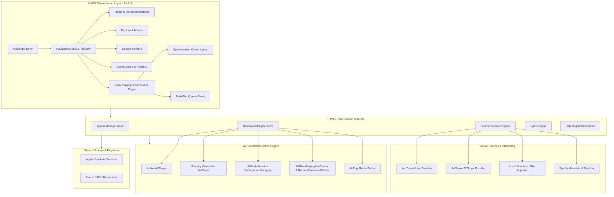

# PROJECT HAWK — ARCHITECTURAL SPECIFICATION & SYSTEM DESIGN

**Document ID:** HAWK-ARCH-001  
**Product Name:** HAWK  
**Version:** 1.0.0-PROPOSAL  
**Author:** Principal iOS Architect & Senior Engineering Team  
**Status:** PROPOSED — PENDING USER APPROVAL  

---

## 1. System Philosophy & Executive Summary

HAWK is an independent, native Apple iOS application designed to provide an uncompromised, audiophile-grade music streaming and local playback experience. Built exclusively in Swift with SwiftUI and AVFoundation, HAWK delivers fluid Apple Human Interface Guidelines (HIG) aesthetics, background audio stability, multi-source stream resolution, hardware-backed security, and local-first privacy.



---

## 2. Audio Pipeline Design

The native audio engine is the foundational core of HAWK. Audio stability and audio fidelity take precedence over visual animations.

### 2.1 Dual-Player Crossfade Architecture
To achieve gapless playback and true studio crossfade (0–12 seconds) without dips in volume:
- Two `AVPlayer` instances (`playerA` and `playerB`) operate in a coordinated ping-pong architecture:
  - While `playerA` reaches `(duration - crossfadeSeconds)`, `playerB` is preloaded with the next queue item, cued to start, and unmuted.
  - An asymmetric equal-power crossfade curve (`gainA = cos(t * π / 2)`, `gainB = sin(t * π / 2)`) is applied smoothly to both players via `AVAudioMix` / volume ramps.
  - Once `playerA` finishes, it is idled, and `playerB` assumes primary status for `MPNowPlayingInfoCenter`.
- If crossfade is set to 0 seconds, `AVQueuePlayer` is utilized for bit-accurate gapless transition.

### 2.2 Audio Session & System Interruption Management
- **Category:** `AVAudioSession.sharedInstance().setCategory(.playback, mode: .default, options: [.allowAirPlay, .allowBluetooth, .allowBluetoothA2DP])`.
- **Interruption Handling:** Responds to `AVAudioSession.interruptionNotification`. On incoming cellular calls or Siri activations, playback automatically pauses smoothly and resumes upon call completion (`AVAudioSession.InterruptionOptions.shouldResume`).
- **Route Changes:** Listens to `AVAudioSession.routeChangeNotification`. When AirPods or headphones are disconnected, playback pauses immediately to prevent unwanted speaker broadcast.

### 2.3 Lock Screen & Control Center (`MediaPlayer`)
- Updates `MPNowPlayingInfoCenter.default().nowPlayingInfo` with title, artist, album, duration, elapsed playback time, and high-resolution `MPMediaItemArtwork`.
- Configures `MPRemoteCommandCenter.shared()` handlers for:
  - Play / Pause / TogglePlayPause
  - NextTrack / PreviousTrack
  - ChangePlaybackPosition (lock screen scrubbing)
  - Like / Dislike (syncing to HAWK Favorites)

### 2.4 In-App Equalizer
- Implemented in HAWK's audio-processing pipeline using `AVAudioUnitEQ` with 10 configurable parametric bands (low shelf at 60Hz, 8 peaking filters, high shelf at 14kHz), bass boost, and treble boost.
- Clear user indicator: Equalizer operates on in-app decoded audio and does not claim to affect system-wide iOS sound.

---

## 3. Music Source Architecture

Each music provider conforms to the strictly typed `MusicSourceProvider` protocol:

```swift
public protocol MusicSourceProvider: Sendable {
    var sourceId: String { get }
    var displayName: String { get }
    var capabilities: Set<SourceCapability> { get }

    func search(query: String, filter: SearchFilter) async throws -> [Song]
    func resolveStream(song: Song, qualityCeiling: AudioQuality) async throws -> SourceStream
    func fetchAlbum(browseId: String) async throws -> AlbumDetail
    func fetchArtist(browseId: String) async throws -> ArtistDetail
}
```

### 3.1 YouTube Music Provider (`YouTubeSource`)
- Communicates directly with `https://music.youtube.com/youtubei/v1` via `URLSession`.
- Uses `WEB_REMIX` client context for rich browsing, charts, playlists, and recommendations.
- For authenticated sessions, reads `SAPISID` cookie from Keychain, generates timestamped `SAPISIDHASH` (SHA-1 HMAC) headers, and synchronizes user library and likes.
- Resolves high-bitrate Opus (160 kbps) and AAC streams with fallback tiers.

### 3.2 JioSaavn Provider (`JioSaavnSource`)
- Resolves 320 kbps high-bitrate AAC audio using standard DES decryption with public CDN endpoints.
- Provides immediate lossless/high-bitrate fallback when available for popular tracks.

### 3.3 Local Music Provider (`LocalLibrarySource`)
- Enables users to import audio files (`.mp3`, `.m4a`, `.flac`, `.wav`, `.alac`) into HAWK's container via `UIDocumentPickerViewController`.
- Extracts embedded ID3/Vorbis metadata, track numbers, and embedded cover art via `AVURLAsset`.

### 3.4 Spotify Metadata Provider & Matcher (`SpotifySource`)
- Connects to user's Spotify account via `ASWebAuthenticationSession` OAuth.
- Retrieves Spotify playlists and Liked Songs metadata.
- Implements `TrackMatcher` confidence scoring (Title + Artist + Album + Duration within ±3 seconds) to map tracks to authorized streaming sources.

---

## 4. Local Storage & Persistence Architecture

HAWK is local-first. It relies on atomic, zero-overhead storage:
1. **Credentials & Tokens:** Apple Keychain Services (`Security.framework`). Zero plaintext storage.
2. **Playlists & Favourites:** Atomically written JSON documents in the app's sandboxed `Application Support` directory, represented by Swift `Codable` models (`PlaylistStore`).
3. **Queue State:** Persistent `BoundedContextState` saved atomically on backgrounding, ensuring the exact track and seek position are restored on launch.
4. **Listening History:** Partitioned into monthly JSON aggregate files (`YYYY-MM.json`), keeping memory footprint minimal while allowing instant yearly Replay calculation.
5. **Cache Eviction:** Temporary audio chunks stored in `Caches/AudioStreams/` with an LRU threshold (configurable in Settings, default 2 GB) that cleans up automatically under storage pressure.

---

## 5. Networking Architecture

- **Engine:** Pure Swift Concurrency with `URLSession`.
- **Session Configuration:** Ephemeral and default sessions with custom HTTP headers, aggressive connection reuse, and timeouts (`requestTimeout: 10s`, `resourceTimeout: 30s`).
- **Retry & Backoff:** Exponential backoff with jitter on transient network errors (HTTP 429, 503, network drops).
- **Network Quality Adaptation:** Monitors `NWPathMonitor` (`Network.framework`) to detect cellular vs. Wi-Fi connections and apply user-selected quality ceilings automatically (e.g. 128 kbps on metered cellular, 320 kbps on Wi-Fi).

---

## 6. Background Execution Strategy

- **Audio Background Mode:** Enabled via `UIBackgroundModes` -> `audio`. The OS permits continuous execution as long as an active `AVPlayer` is outputting audio.
- **Audio Session Activation:** Audio session is activated immediately prior to playback start and deactivated gracefully upon queue exhaustion or explicit pause to conserve battery.
- **Background Downloads:** Scheduled using `URLSessionConfiguration.background(withIdentifier:)` so that permitted offline downloads continue even if HAWK is suspended.

---

## 7. Security Model & Authentication

- **No Secrets in Source:** All client IDs or user tokens are dynamic. No hardcoded credentials exist.
- **Keychain Enclave:** Master auth cookies stored in Keychain with `kSecAttrAccessibleWhenUnlockedThisDeviceOnly`.
- **Secure Web Auth:** `ASWebAuthenticationSession` ensures Google and Spotify sign-ins occur in private browser sandboxes with PKCE where supported.
- **Data Erasure:** Complete local data wipe capability in Settings > Privacy.

---

## 8. Original HAWK Design System

HAWK features a distinct, Apple-native visual identity:
- **Typography:** Apple San Francisco (`SF Pro Display` for titles, `SF Pro Text` for body, `SF Compact` for transport times). Full Dynamic Type support.
- **Translucency & Materials:** SwiftUI `.ultraThinMaterial` and `.bar` backing bottom navigation tabs and player dock.
- **Kinetic Artwork Backdrop:** Dynamic 4-color mesh gradient dynamically extracted from current album art via `CoreImage`, animating subtly at 60 fps.
- **Now Playing Sheet:** Fluid drag-to-dismiss gesture matching Apple Music navigation feel.
- **Accessibility:** Full VoiceOver labeling on all player transport controls, high-contrast text ratios, and `accessibilityReduceMotion` observance.

---

## 9. Build, Signing & Release Strategy

- **Hardware Target:** iPhone 12 (iOS 17.0+).
- **Free Apple Developer Account Constraints:**
  - 7-day provisioning profile expiration.
  - Maximum 3 sideloaded active apps.
  - No Apple Developer Program capabilities (no Push Notifications, no public TestFlight, no App Store).
- **Sideloading Target:** **AltStore Classic** (or SideStore / TrollStore).
- **IPA Build Automation:**
  - Build script `Scripts/build_ipa.sh` builds the release archive using `xcodebuild archive`, exports the application bundle, signs it with the user's personal development identity or creates an unsigned release IPA ready for AltServer automatic signing on installation.
- **CI/CD:** Free GitHub Actions workflow (`.github/workflows/ci.yml`) compiling Swift packages, running unit tests, and validating dependencies.

---

## 10. Estimated Development Milestones

- **M0:** Environment Reconnaissance & Project Status (Complete)
- **M1:** Reference Repository Audit (Complete)
- **M2:** Architecture Proposal & Approval (Current Stop Point)
- **M3:** Project Foundation & Modular Swift Packages Setup
- **M4:** Original HAWK Design System & SwiftUI Navigation
- **M5:** Core Domain, Data Models & Local Storage Engine
- **M6:** AVFoundation Playback Engine, Crossfade & Lock Screen
- **M7:** YouTube Music & JioSaavn Source Resolvers
- **M8:** Synchronized Lyrics, Playlists & Offline Downloads
- **M9:** Replay Statistics & Apple AirPlay Integration
- **M10:** Automated Unit & Integration Testing
- **M11:** Build Scripts & GitHub Actions CI Automation
- **M12:** Release IPA Packaging & AltStore Installation Verification
