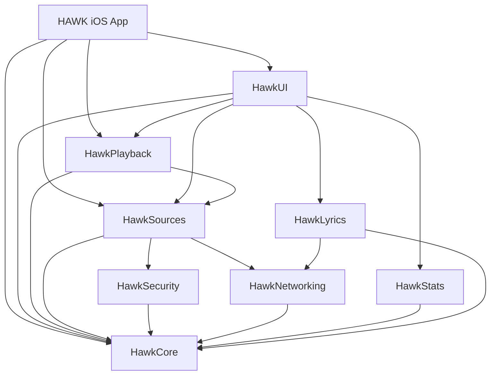
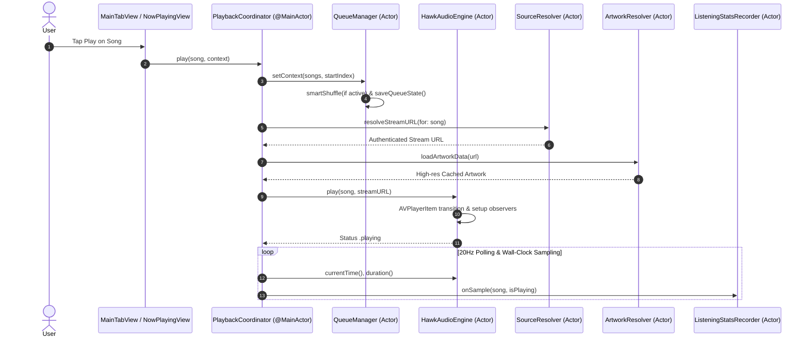

# HAWK 2.0 — SYSTEM ARCHITECTURE DOCUMENTATION
## Autonomous Principal Software Engineering & Architectural Blueprint

**Version:** 2.0.0  
**Target Platform:** iOS 17.0+ / iPadOS 17.0+  
**Architecture:** Modular SPM Multi-Package Actor Architecture  
**Concurrency Model:** Swift 6 Strict Concurrency (`Sendable`, Actor Isolation)  
**Primary Language:** Swift 6  
**UI Framework:** SwiftUI with Monochromatic Design Language  

---

## 1. Executive Summary & Architectural Vision

PROJECT HAWK 2.0 transforms the original client into a production-grade, highly performant, distraction-free music streaming ecosystem. Built upon Swift 6 strict concurrency guarantees and a modular actor-isolated framework, HAWK 2.0 eliminates UI hitching, memory leaks, data races, and vendor lock-in.

### Key Architectural Pillars:
1. **Multi-Package Concurrency Isolation:** Strict dependency layering separating Core domain entities, Security, Networking, Audio Engine, Metadata Resolvers, Statistics, and SwiftUI Presentation.
2. **Unified Monochromatic Design System:** Strict monochrome icon hierarchy across all 9 library categories, eliminating visual noise and focusing user attention on artwork and music.
3. **Multi-Provider Hybrid Federation:** Federated live search, playback resolution, and library ingestion across local files, downloads, YouTube Data API v3, and JioSaavn lossless/high-bitrate streams.
4. **On-Device Recommendation & Intelligence:** Local explainable ranking engine with exponential time decay, favorites affinity, skip penalties, and contextual discovery shelves.
5. **Two-Tier Resilient Caching:** In-memory LRU cache combined with a bounded on-disk SHA-256 persistent storage tier and actor-isolated in-flight network deduplication.

---

## 2. Package & Layer Dependency Graph

### Module Responsibilities:
- `HawkCore`: Domain primitives (`Song`, `Playlist`, `AudioQuality`, `PlaybackState`, `TrackDeduplicator`).
- `HawkSecurity`: RFC 7636 PKCE, SHA-256 / HMAC, KeychainStore, DES decryption.
- `HawkNetworking`: SSRF-protected HTTP client, DNS rebinding guards, exponential backoff with jitter.
- `HawkSources`: Multi-source resolvers (`YouTubeSource`, `JioSaavnSource`, `LocalLibrarySource`, `DownloadManager`, `GoogleMusicSyncManager`, `GoogleJwksService`, `ArtworkResolver`, `UniversalSearchEngine`).
- `HawkPlayback`: Audio engine (`HawkAudioEngine`), queue state machine (`QueueManager`), equalizer (`EqualizerManager`), sleep timer (`SleepTimerManager`), CarPlay sync (`CarPlaySyncManager`).
- `HawkLyrics`: LRCLIB live synchronized lyrics parser and real-time word-level synchronization engine.
- `HawkStats`: Wall-clock listening sampler (`ListeningStatsRecorder`), monthly replay aggregations (`MonthlyBucket`), personalized ranking (`RecommendationEngine`).
- `HawkUI`: Design system tokens (`HawkTypography`, `HawkSpacing`, `HawkRadius`, `HawkTheme`), reusable components (`HawkButton`, `HawkCard`, `HawkArtwork`, `HawkSearchField`, `HawkTabBar`), and full views.

---

## 3. Data & Playback Pipeline Flow

---

## 4. Swift 6 Concurrency & Strict Isolation Strategy

1. **Global Actor Declarations:**
   - All presentation coordinators (`PlaybackCoordinator`, `GoogleMusicSyncManager`, `SleepTimerManager`) are strictly isolated to `@MainActor`.
   - UI views access mutable state via `@Observable` properties guaranteed to dispatch mutations on the main runloop.
2. **Background Actor Boundaries:**
   - Storage engines, audio hardware management, and network caches are isolated in dedicated `actor` definitions (`QueueManager`, `ListeningStatsRecorder`, `RecommendationEngine`, `ArtworkResolver`, `UniversalSearchEngine`, `PlaylistStore`, `DownloadManager`).
   - Cross-actor message passing is asynchronous (`await`) and restricted to `Sendable` types.
3. **Data Immutability & Thread Safety:**
   - `Song`, `Playlist`, `MonthlyBucket`, `UniversalSearchResults`, and `RecommendedTrack` are immutable `Sendable` structs.
   - Core cryptography wrappers (`SendableSecKey`) maintain memory isolation while crossing actor boundaries.

---

## 5. Security & Authentication Architecture

1. **RFC 8252 & RFC 7636 OAuth PKCE:**
   - Cryptographically random 32-byte verifier and base64url SHA-256 code challenge.
   - Cryptographic state and nonce verification preventing authorization code injection and replay attacks.
2. **Cryptographic JWT ID Token Verification:**
   - Dynamic fetching of Google's public signing keys (`https://www.googleapis.com/oauth2/v3/certs`).
   - In-memory ASN.1 DER parser constructing valid `SecKey` instances.
   - Verification of RS256 signature using `SecKeyVerifySignature`.
   - Strict validation of `iss`, `aud`, `exp`, `iat`, and `nonce` claims before user account acceptance.
3. **Private Key & Token Protection:**
   - Zero credentials stored in cleartext. Refresh tokens, access tokens, and user identities are encrypted in the iOS Keychain with `kSecAttrAccessibleAfterFirstUnlockThisDeviceOnly`.
4. **Network & SSRF Hardening:**
   - `HawkHttpClient` validates target hosts and disallows loopback (`127.0.0.1`), link-local (`169.254.0.0/16`), and private RFC 1918 subnets for non-local stream resolutions.
