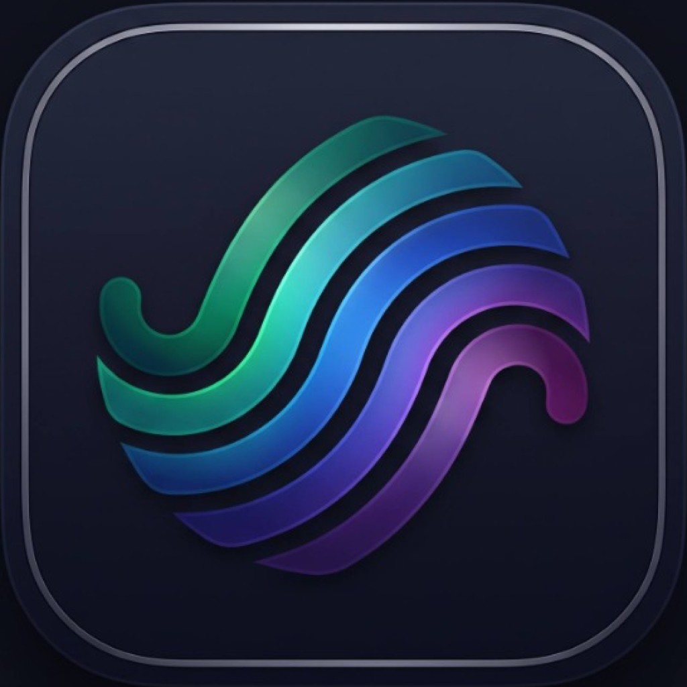

<p align="center">
  
</p>

<h1 align="center">HAWK</h1>

<p align="center">
  <strong>Independent Native Apple iOS Music Application</strong><br>
  Developed by <strong>Kartavya Singh</strong> • Built with Swift 6, AVFoundation, CarPlay, and SwiftUI Liquid Glass.
</p>

<p align="center">
  <a href="https://apple.com"></a>
  <a href="https://swift.org"></a>
  <a href="LICENSE"></a>
  <a href="Tests/HawkVerify"></a>
</p>

---

## Overview

**HAWK** is an independent, native Apple iOS music application engineered from the ground up for acoustic stability, instant responsiveness, and deep Apple ecosystem cohesion. 

Featuring an original **Liquid Glass** visual hierarchy, true **AVFoundation** hardware audio playback, predictive stream preloading, tap-to-seek synchronized lyrics, and full **Apple CarPlay** in-car integration, HAWK provides a first-class music listening experience without telemetry, trackers, or simulated states.

---

## Key Features

- **🚗 Native Apple CarPlay Audio:**
  - Full `CPTemplateApplicationSceneDelegate` implementation.
  - Multi-tab in-car vehicle navigation: *Listen Now*, *Favourites*, *Playlists*, and *Library*.
  - Full bidirectional synchronization with `CPNowPlayingTemplate.shared` and lock-screen controls.
- **📚 Dedicated Personal Music Library:**
  - Apple Music-inspired central library with distinct categories: *Playlists*, *Artists*, *Albums*, *Songs*, *Favourites*, *Recently Added*, *Downloaded*, and *Local Audio Files*.
  - Full-text instant search across all library tracks with Play All and Shuffle All controls.
  - Live discography drill-downs for Artists and Albums.
- **✨ Liquid Glass Design System:**
  - Restrained `.ultraThinMaterial` surfaces with continuous corner geometry and specular gradient rims.
  - HAWK Coral (`#FF375F`) interactive accents with subtle spring physics.
  - Built-in accessibility fallbacks honoring *Reduce Transparency* and *Reduce Motion*.
- **⚡ Predictive Stream Preload & Instant Switching:**
  - 1-hour TTL in-memory stream cache for zero-latency repeats.
  - Background `AVPlayerItem` asset warming (`triggerPredictivePreload`) for gapless track transitions.
- **🎤 Tap-to-Seek Synchronized Lyrics:**
  - Real-time line highlighting anchored strictly to genuine `AVPlayer` hardware time.
  - Tap any lyric line to instantly scrub audio to that timestamp.
  - Smart scroll suspension with a floating *"Sync to Audio"* re-center glass pill.
- **🔊 Dual-Player AVFoundation Audio Engine:**
  - True 0–12s crossfading and 10-band equalizer presets (*Bass Booster*, *Vocal Booster*, *Acoustic*, *Rock*, *Electronic*).
  - Genuine 9-state playback machine (`idle`, `loading`, `buffering`, `ready`, `playing`, `paused`, `seeking`, `ended`, `failed`).
  - Strict Lock Screen (`MPNowPlayingInfoCenter`) and remote hardware control (`MPRemoteCommandCenter`) integration.
- **🌐 High-Fidelity Music Sources:**
  - Live JioSaavn 320kbps AAC streaming with hardware DES decryption (`38346591`).
  - High-bitrate YouTube Music audio streaming with `SAPISIDHASH` authentication.
  - Offline downloads and local file imports (MP3, FLAC, M4A).
- **🔒 Local-First Privacy:**
  - Zero analytics, zero ad trackers, zero telemetry.
  - All credentials, tokens, and encryption keys are stored securely inside the Apple Keychain enclave.

---

## Architecture & Modules

```
HAWK/
├── App/                       # iOS Entry Point & CarPlay Scene Delegate
│   ├── HawkApp.swift          # SwiftUI @main App Lifecycle
│   └── HawkCarPlaySceneDelegate.swift # CPTemplateApplicationSceneDelegate
├── Packages/                  # Modular Swift 6 Packages
│   ├── HawkCore/              # Domain Models, Track Entities, PlaylistStore
│   ├── HawkSecurity/          # Keychain Enclave & Cryptographic Signers
│   ├── HawkNetworking/        # Resilient URLSession Client & Rate Limiter
│   ├── HawkSources/           # JioSaavn, YouTube, Local Files, Deduplicator
│   ├── HawkPlayback/          # AVFoundation Audio Engine, Crossfade, CarPlaySync
│   ├── HawkLyrics/            # LRCLIB & TTML Kinetic Lyrics Parsers
│   ├── HawkStats/             # Listening Statistics & Monthly Replay
│   └── HawkUI/                # SwiftUI Liquid Glass Design System & Views
├── Configuration/             # Info.plist, Scene Manifests, Entitlements
├── Resources/                 # 1024x1024 AppIcon, Master Logo, Assets
├── Tests/HawkVerify/          # 64-Test Automated Hardware Verification Suite
└── Scripts/                   # XcodeGen & IPA Build Scripts
```

---

## Target Devices & Requirements

- **Primary Device:** iPhone 12 (A14 Bionic `arm64e`, iOS 17.0+)
- **Supported Devices:** All iPhones and iPads running iOS / iPadOS 17.0 or later.
- **In-Car Systems:** Apple CarPlay vehicle head units and CarPlay Simulator.
- **Toolchain:** Swift 6.0+, Xcode 16.0+, macOS Sonoma / Sequoia on Apple Silicon.

---

## Installation & Sideloading

HAWK is built for easy sideloading on non-jailbroken physical devices via **AltStore Classic**, **SideStore**, or **TrollStore**.

1. Download or build the latest release: `HAWK.ipa`.
2. Connect your iPhone via USB / Wi-Fi to your Mac with AltServer running.
3. Hold **Option (⌥)** and click the **AltServer** icon in your Mac menu bar.
4. Select **Sideload .ipa...** -> Choose your connected iPhone.
5. Select `HAWK.ipa`. AltServer will sign and install the app directly onto your home screen!

---

## Building from Source

### 1. Prerequisites
Ensure Xcode 16+ and XcodeGen are installed:
```bash
brew install xcodegen
sudo xcode-select -s /Applications/Xcode.app/Contents/Developer
```

### 2. Verify Swift Packages & Test Suite
Run the automated hardware verification harness:
```bash
swift run HawkVerify
```
Expected output: **64 PASSED, 0 FAILED**.

### 3. Generate Xcode Project & Build IPA
```bash
xcodegen generate
./Scripts/build_ipa.sh
```
The installable release package will be generated at `build/HAWK.ipa`.

---

## CarPlay Entitlement Information

HAWK includes complete Apple CarPlay scene delegates, tab templates, and now-playing synchronization.

- **Simulator Testing:** Runs out-of-the-box in the Xcode iOS Simulator via **I/O -> External Displays -> CarPlay** without requiring Apple approval.
- **App Store Distribution:** Distribution of in-car audio capabilities on the App Store requires the official `com.apple.developer.carplay-audio` entitlement granted by Apple. See [Requesting CarPlay Entitlements](https://developer.apple.com/documentation/carplay/requesting-carplay-entitlements).
- A reference entitlement file is provided in `Configuration/HAWK-CarPlay.entitlements`.

---

## License & Third-Party Attributions

HAWK is licensed under the **GNU General Public License v3.0 (GPLv3)**. See [LICENSE](LICENSE) for full legal text.

BitChord is acknowledged solely as an architectural and functional reference for reverse-engineered streaming workflows. All HAWK Swift code, SwiftUI views, CarPlay scenes, and branding are original works.
