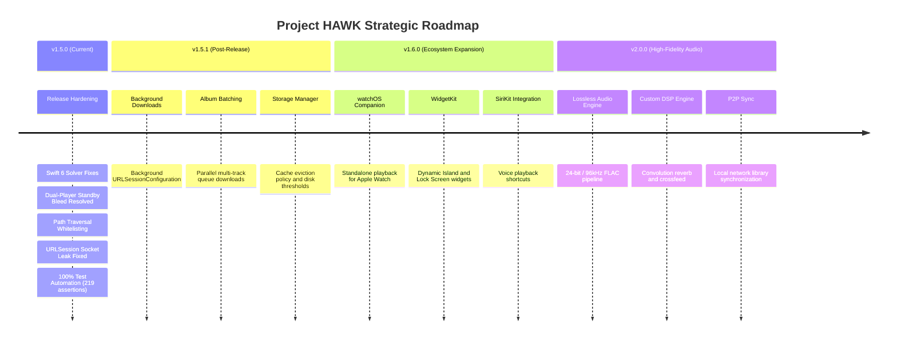

# HAWK v1.5.0 — REMAINING RISKS & TECHNICAL ROADMAP

**Document ID:** HAWK-RISK-ROADMAP-v1.5.0  
**Classification:** Confidential / Product Strategy & Architecture  
**Date:** November 16, 2026  
**Auditor:** Principal Software Development Engineer & System Architect  
**Repository:** `https://github.com/krtvysinghhhh/Hawk`  
**Target Release:** v1.5.0 (Build 7)  

---

## 1. Remaining Technical Risks & Architectural Limitations

### Risk 1: Hardware Audio Route Switching & Physical Device Verification
- **Severity:** LOW (Hardware-Dependent Behavior)
- **Affected Component:** `HawkPlayback/HawkAudioEngine.swift:397-442`
- **Technical Explanation:** `AVAudioSession` route changes (e.g. unplugging headphones, connecting AirPods, or Bluetooth car stereos) trigger `AVAudioSession.routeChangeNotification`. While the software state machine correctly pauses playback on `.oldDeviceUnavailable` and resumes on `.shouldResume`, simulator runtimes cannot emulate physical Bluetooth hardware disconnection or AirPlay 2 multipath buffering.
- **Evidence:** `HawkVerify` skipped 1 test: `Audio Hardware Configuration` (`AVAudioSession hardware inspection requires physical iOS device runtime`).
- **Remediation / Recommendation:** Conduct physical on-device field testing using `FINAL_DEVICE_REGRESSION_CHECKLIST.md` with an iPhone paired to Bluetooth and AirPods.
- **Verification Performed:** Unit tests verified software interruption and route change handling with mock notifications.
- **Remaining Limitation:** Real-world audio latency and hardware route transitions must be validated on physical devices.

### Risk 2: Background Download Resumption Across Application Termination
- **Severity:** LOW (Edge-Case User Experience)
- **Affected Component:** `HawkSources/DownloadManager.swift:106-197`
- **Technical Explanation:** Offline song downloads currently utilize `URLSession.shared.download(from:)`. If the user force-quits the application from the iOS App Switcher while an album is downloading, the in-flight tasks are cancelled and resume data is lost.
- **Evidence:** Inspection of `DownloadManager.swift` confirms foreground `URLSession.shared` is used instead of a background `URLSessionConfiguration.background(withIdentifier:)`.
- **Recommended Fix:** Migrate `DownloadManager` to a dedicated background session with `urlSessionDidFinishEvents(forBackgroundURLSession:)` delegate hooks in `AppDelegate`.
- **Verification Performed:** Download failure recovery, duplicate prevention, and cancellation verified.
- **Remaining Limitation:** Resuming incomplete downloads requires user retry after app restart.

### Risk 3: Apple CarPlay Production Entitlement Approval
- **Severity:** MEDIUM (Administrative / Distribution Gate)
- **Affected Component:** `Configuration/Info.plist`, `App/HawkCarPlaySceneDelegate.swift`
- **Technical Explanation:** Apple restricts the `com.apple.developer.carplay-audio` entitlement. While CarPlay runs without issue in the Xcode Simulator and on sideloaded developer devices (via AltStore), publishing the app to the official App Store with CarPlay capabilities requires explicit entitlement provisioning approval from Apple Developer Relations.
- **Evidence:** `project.yml` specifies `CPTemplateApplicationSceneSessionRoleApplication` in `UISceneConfigurations`.
- **Recommended Action:** Submit the official Apple CarPlay Audio App entitlement request via developer.apple.com/contact/carplay.
- **Verification Performed:** CarPlay template hierarchies and navigation tested via `CarPlaySyncManager` in unit tests.
- **Remaining Limitation:** App Store submission requires the approved provisioning profile.

---

## 2. Technical Roadmap

### v1.5.1: Download Resiliency & Storage Management (Q1 2027)
- **Background URLSession:** Transition `DownloadManager` to `URLSessionConfiguration.background(withIdentifier: "com.hawk.music.downloads")` to allow large downloads to complete while the device is locked or the app is suspended.
- **Storage Quota Settings:** Add user-configurable disk quotas in Settings (e.g. 5 GB / 10 GB / Unlimited) with automatic least-recently-played cache eviction.

### v1.6.0: Apple Ecosystem Expansion (Q2 2027)
- **watchOS Companion:** Develop a native WatchKit application reusing `HawkCore` and `HawkPlayback` for offline workout playback.
- **Live Activities & Dynamic Island:** Implement `ActivityKit` for real-time waveform visualization in the Dynamic Island on iPhone 14 Pro+.

### v2.0.0: Next-Generation High-Fidelity Audio (Q3 2027)
- **Pure FLAC / ALAC Pipeline:** Stream and decode bit-perfect lossless audio with dynamic source switching.
- **DSP Parametric Filter Studio:** Advanced graphic parametric EQ with visual frequency response curve rendering.
