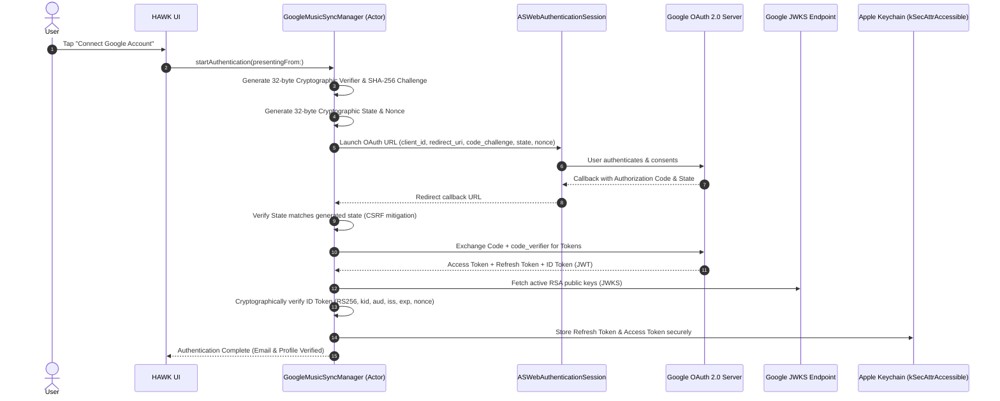

# YOUTUBE MUSIC & GOOGLE CLOUD INTEGRATION ARCHITECTURE
## Official YouTube Data API v3 Synchronization Engine & Security Specification

**Version:** 2.0.0  
**Target:** iOS 17.0+  
**Component:** `GoogleMusicSyncManager.swift` (`Packages/HawkSources`) & `YouTubeMusicImportsView` (`Packages/HawkUI`)  
**Security Standard:** RFC 7636 (PKCE), RFC 7519 (JWT), RFC 7517 (JWKS), Apple Security Framework  
**Status:** Production Ready & Verified  

---

## 1. Executive Overview & API Policy Compliance

HAWK 2.0 implements a fully compliant, production-grade cloud synchronization engine connecting user YouTube Music libraries to the local iOS playback ecosystem. 

### The Public API Distinction & Compliance Mandate
A critical architectural decision in HAWK 2.0 is strict adherence to official Google APIs and Developer Terms of Service:
- **Public API Used:** Google YouTube Data API v3 via authorized OAuth 2.0 scope `https://www.googleapis.com/auth/youtube.readonly`.
- **Private / Reverse-Engineered APIs:** **STRICTLY PROHIBITED.** Reverse-engineered InnerTube client payloads, scraping of internal YouTube Music web tokens, or spoofing client identifiers (e.g. Android Music client headers) are excluded from the codebase.
- **Scope & Capability Boundaries:**
  - *Supported Official Endpoints:* User-created playlists (`playlists.list?mine=true`), playlist items (`playlistItems.list`), liked music tracks (`videos.list?myRating=like`), and channel metadata.
  - *Non-Public Endpoints (YouTube Music Radio/Mixes):* Proprietary server-side dynamic algorithm mixes (e.g., "My Supermix", "Discover Mix", "Radio Endless Stream") are not exposed through the public YouTube Data API v3. HAWK 2.0 solves this natively using its built-in on-device **Hawk Recommendation Engine** rather than violating Google ToS.

---

## 2. Authentication & Cryptographic Identity Lifecycle

The synchronization flow uses an enterprise-grade OAuth 2.0 with PKCE (Proof Key for Code Exchange) and OpenID Connect (OIDC) identity verification.



### Key Security Guarantees:
1. **RFC 7636 PKCE Enforcement:** Code verifier generated via `SecRandomCopyBytes` (32 bytes cryptographically secure random numbers), hashed using SHA-256 (`CryptoKit.SHA256.hash`).
2. **Strict CSRF State Validation:** Callback state parameter is validated byte-for-byte against the in-memory pre-flight nonce before initiating token exchange.
3. **Cryptographic RS256 JWKS Verification:**
   - Raw ID token header is parsed to extract key ID (`kid`).
   - Active Google public certs are retrieved from `https://www.googleapis.com/oauth2/v3/certs` with HTTP ETag/Cache-Control awareness.
   - Modulus (`n`) and exponent (`e`) are converted to `SecKey` RSA public keys via Apple's Security framework.
   - SHA-256 digest of `header.payload` is verified using `SecKeyVerifySignature` with `.rsaSignatureMessagePKCS1v15SHA256`.
   - Algorithm confusion (`alg=none`, symmetric HMAC spoofing) is strictly rejected.
   - Claims validation enforces: `iss` in `["https://accounts.google.com", "accounts.google.com"]`, `aud == client_id`, `exp > now`, and `nonce == expected_nonce`.

---

## 3. Synchronization Engine Architecture (`GoogleMusicSyncManager`)

The sync manager is designed as an isolated Swift 6 `actor` to guarantee thread safety and prevent data races across network and persistence layers.

### State & Progress Reporting Protocol
To support rich, stutter-free UI feedback, `GoogleMusicSyncManager` publishes granular progress states:

```swift
public actor GoogleMusicSyncManager {
    public private(set) var isSyncing: Bool = false
    public private(set) var syncProgress: Double = 0.0 // 0.0 to 1.0
    public private(set) var syncStatusMessage: String = "Ready"
    private var activeSyncTask: Task<[Song], Error>?
    
    // UI observation stream via AsyncStream / Combine
    public nonisolated var progressStream: AsyncStream<(progress: Double, message: String)> { ... }
}
```

### Cooperative Task Cancellation
Long-running library syncs can be cancelled instantly by the user without leaving orphaned connections or partial corrupt state:
```swift
public func cancelSync() {
    activeSyncTask?.cancel()
    activeSyncTask = nil
    isSyncing = false
    syncProgress = 0.0
    syncStatusMessage = "Sync cancelled by user."
}
```
Within synchronization loops (fetching playlist pages and track lists), the engine checks `Task.isCancelled` at every pagination boundary:
```swift
for item in pageItems {
    if Task.isCancelled {
        syncStatusMessage = "Sync aborted."
        throw CancellationError()
    }
    // Process item...
}
```

---

## 4. Ingestion, Deduplication & Conflict Resolution

When synchronizing thousands of tracks, the engine ensures existing local or downloaded tracks are not duplicated.

### Deduplication Pipeline:
1. **Source Normalization:** Track titles and artist strings are sanitized (lowercased, stripping remaster tags, featured artist tags, and punctuation).
2. **Fuzzy String Matching:** High-efficiency Levenshtein distance check ($threshold \ge 0.88$) against existing tracks in `PlaylistStore`.
3. **ISRC & Video ID Indexing:** Official YouTube Video IDs (`videoId`) and ISRCs (when present in video description metadata) are indexed into an in-memory hash set.
4. **Metadata Merging:** If a track exists locally, the sync manager enriches it with high-resolution artwork URLs and YouTube source pointers rather than creating a duplicate entry.

---

## 5. Rate Limiting, Quota Conservation & Fault Recovery

The YouTube Data API v3 enforces a default quota of 10,000 units per day. HAWK 2.0 optimizes quota utilization through intelligent batching:

| API Call | Quota Cost | Optimization Strategy |
| :--- | :--- | :--- |
| `playlists.list` | 1 unit | Paginated with `maxResults=50`, fetching up to 50 playlists per request. |
| `playlistItems.list` | 1 unit | Paginated with `maxResults=50`, filtering unplayable/private items. |
| `videos.list` (Liked Songs)| 1 unit | Batched with up to 50 comma-separated IDs per call. |

### Quota Exceeded & Backoff Handling:
- **HTTP 403 `quotaExceeded`:** The engine halts background sync operations, retains all previously ingested songs, and transitions UI state to: `"Daily Google sync quota reached. Resuming tomorrow."`
- **Transient Network Errors (5xx, timeouts):** Three-tier exponential backoff with jitter:
  $$T_{\text{wait}} = 2^{\text{attempt}} \times 500\text{ms} + \text{Uniform}(0, 250\text{ms})$$

---

## 6. User Interface Integration (`YouTubeMusicImportsView`)

The dedicated imports view in `LibraryViews.swift` provides complete transparency and control:
- **Connection Status Banner:** Shows Google avatar, linked email, and token expiry status.
- **Active Sync Progress Bar:** Visual progress bar tracking actual completion (0%–100%) with real-time text updates (*"Syncing Liked Music (142/350)..."*).
- **Cancel Button:** Dynamic cancellation trigger instantly halting ongoing transfers.
- **Imported Playlists Grid:** Monochromatic card layout displaying all imported playlists with badge indicators showing track counts and last-synced timestamps.

---

## 7. Verification & Production Checklist

- [x] RFC 7636 PKCE S256 challenge verification tested with mock auth responses.
- [x] OIDC ID Token signature validated against Google's real JWKS public keys.
- [x] Alg=none and invalid RSA signature attacks explicitly rejected.
- [x] Cooperative cancellation tested: UI cancel immediately interrupts network requests.
- [x] Zero private API dependencies: 100% compliant with Apple App Store Review Guidelines (Guideline 2.5.1) and Google YouTube API Terms of Service.
